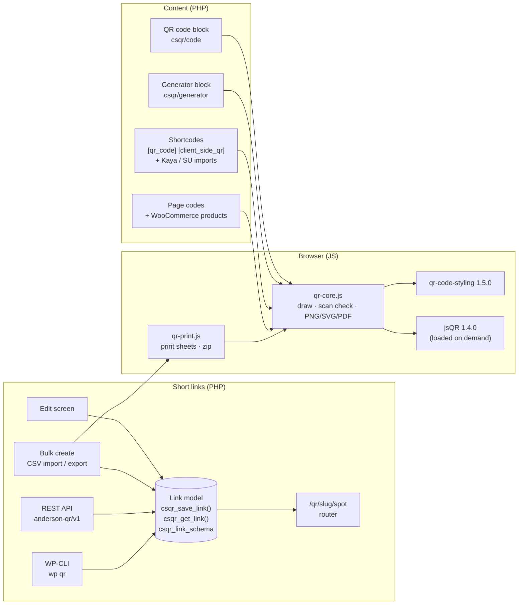
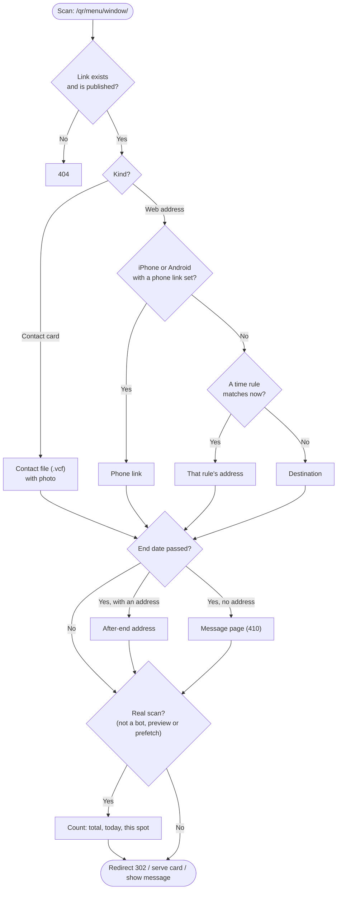
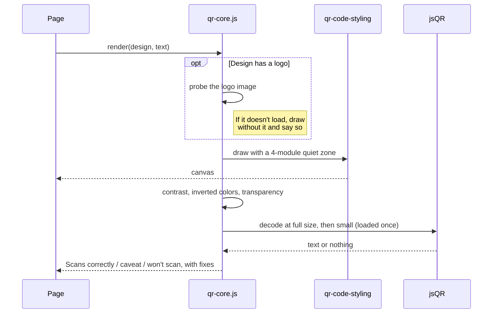
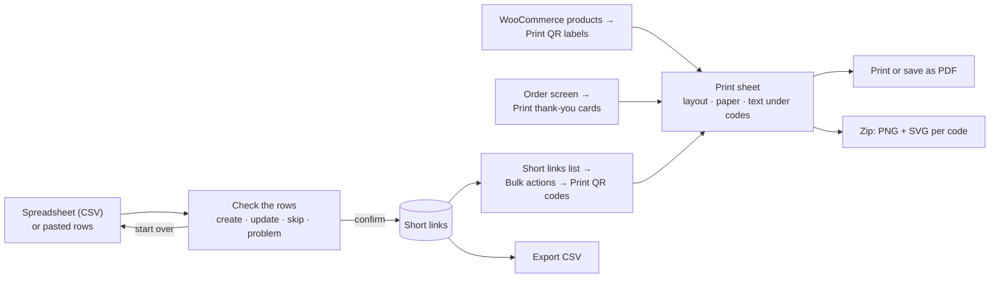
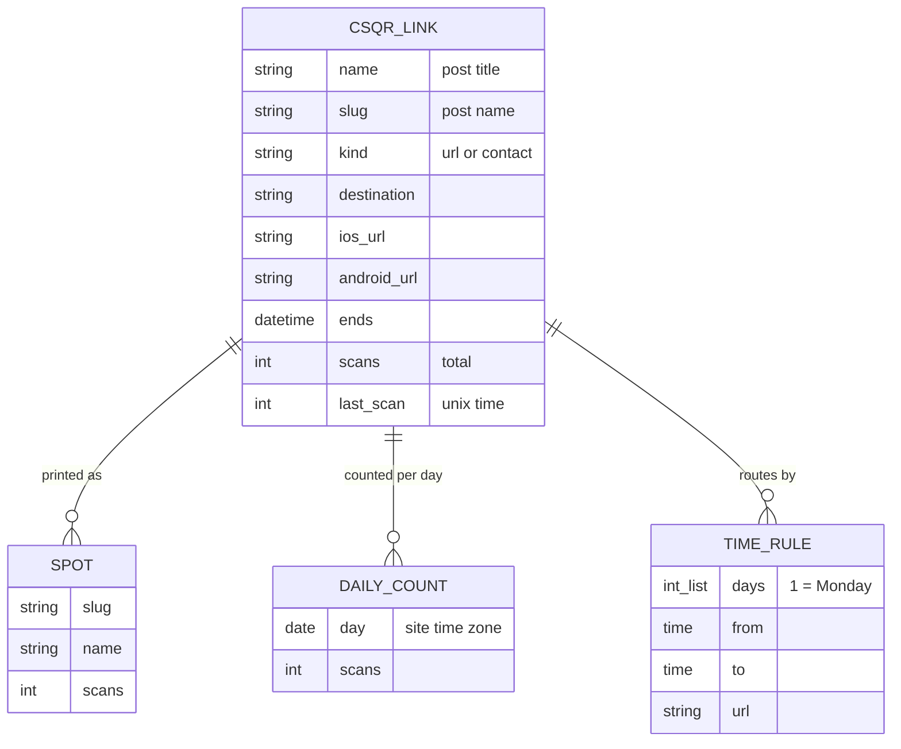
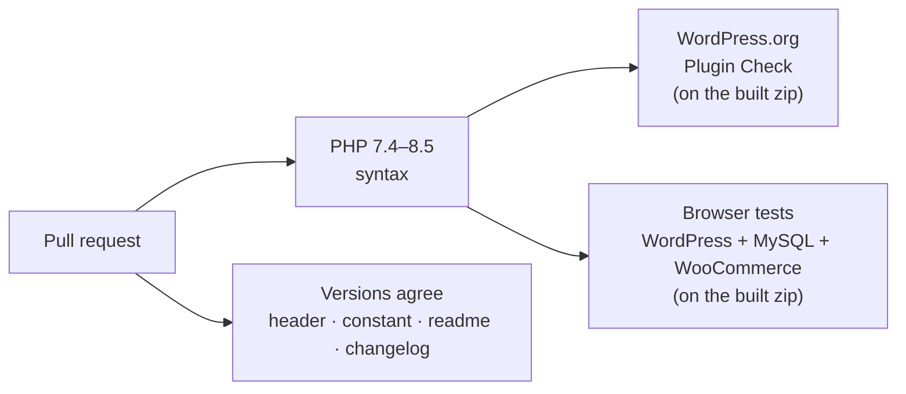

# Anderson QR Code Generator

A WordPress plugin that makes styled QR codes in the browser, with no outside QR service, checks that each code scans before you print it, and gives you short links you can repoint after printing.

| | |
| --- | --- |
| **Version** | `4.4.0` |
| **WordPress.org** | `anderson-qr-code-generator` (pending review) |
| **Requires** | WordPress 6.0+, PHP 7.4+ (tested to WordPress 7.1, PHP 8.5) |
| **License** | GPL-2.0-or-later |
| **Outside services** | None. Codes are drawn and checked in the browser; scans are counted on your own site. |

**Contents:** [Features](#features) · [How it fits together](#how-it-fits-together) · [What happens when someone scans](#what-happens-when-someone-scans) · [The scan check](#the-scan-check) · [Bulk create and print](#bulk-create-and-print) · [Blocks and shortcodes](#blocks-and-shortcodes) · [Short link fields](#short-link-fields) · [REST API](#rest-api) · [WP-CLI](#wp-cli) · [Hooks](#hooks-for-developers) · [Stored data and privacy](#stored-data-and-privacy) · [Development](#development)

---

## Features

| Feature | What it does | Where |
| --- | --- | --- |
| **Scan check** | Decodes every code right after drawing it and checks contrast, inverted colors and transparency, with one-click fixes | Everywhere a code is drawn |
| **Short links** | `yoursite.com/qr/menu` redirects (302) to a destination you can change any time | QR Codes → Short links |
| **Scan history** | Scans per day for 400 days, as a chart with a table view | Short link screen |
| **Spots** | One link printed in several places, each with its own code (`/qr/menu/window`) and count | Short link screen |
| **Time rules** | Different destinations by day of the week and time of day | Short link screen |
| **Phone links** | Separate destinations for iPhone/iPad and Android | Short link screen |
| **End date** | After a date, go to another address or show a message (HTTP 410) | Short link screen |
| **Contact cards** | A short link that serves a `.vcf` contact file with a photo, so the code stays small and editable | Short link screen |
| **Page codes** | A "scan to open this page" card on chosen post types, switchable per page | Settings, editor sidebar |
| **Print-ready files** | PNG at 300 dpi, SVG sized in cm or inches, one-page PDF, with the scanning distance | Every code card |
| **Logos** | From the Media Library; error correction and size are set so the code still scans | Settings, blocks, saved styles |
| **Saved styles** | Reusable colors, shapes and logo (`style="id"`) | QR Codes → Saved styles |
| **Bulk create** | Short links from a spreadsheet, checked before anything is written; CSV export | QR Codes → Bulk create |
| **Print sheets** | Cut-out grid, table tents or name badges on Letter or A4, plus a zip of PNG and SVG | Bulk actions → Print QR codes |
| **WooCommerce** | Product page codes, shelf labels (name, price, SKU), order thank-you cards | Products, orders |
| **Switching plugins** | `[kaya_qrcode]`, `[kaya_qrcode_dynamic]` and `[su_qrcode]` keep working after those plugins are off | Automatic |
| **REST API and WP-CLI** | Manage links across many sites | `anderson-qr/v1`, `wp qr` |
| **Visitor generator** | A form for links (with campaign tags), WiFi, contacts, email, SMS, crypto and PayPal | Block, `[client_side_qr]` |

---

## How it fits together

PHP decides *what* a code holds and where a short link goes. The browser draws every code and checks it. Every way of managing links (the edit screen, bulk import, REST and WP-CLI) goes through one link model, so a field added there works everywhere.



| File | Responsibility |
| --- | --- |
| `client-side-qr.php` | Bootstrap, settings, asset registration, the generator block and `[client_side_qr]` |
| `includes/payloads.php` | What codes hold (WiFi and vCard escaping) and the shared code card |
| `includes/code-block.php` | The QR code block and `[qr_code]` |
| `includes/links.php` | Short links: post type, router, link model, edit screen |
| `includes/link-stats.php` | Scan history, spots, the chart |
| `includes/link-rules.php` | Time rules, phone links, end dates |
| `includes/link-contact.php` | Contact-card links (`.vcf` with photo) |
| `includes/bulk.php` | Bulk create, export, print sheets |
| `includes/page-qr.php` | Per-page codes |
| `includes/styles.php` | Saved styles |
| `includes/woocommerce.php` | Product codes, labels, order cards (loads only with WooCommerce) |
| `includes/compat.php` | Other plugins' shortcodes |
| `includes/rest.php`, `includes/cli.php` | REST API, WP-CLI |
| `includes/admin.php` | QR Codes menu, settings page, shortcode builder |
| `assets/qr-core.js` | Drawing, the scan check, exports |
| `assets/qr-ui.js` | Scan-check status, print-size picker, code cards |
| `assets/qr-script.js` | The visitor generator |
| `assets/qr-print.js`, `qr-print.css` | Print sheets and zip |
| `assets/qr-editor.js`, `qr-code-block.js`, `qr-block.js`, `qr-editor-panel.js` | Block editor |
| `assets/qr-admin.js`, `qr-admin.css` | Admin screens |
| `assets/vendor/` | qr-code-styling 1.5.0 (MIT), jsQR 1.4.0 (Apache-2.0) |
| `tests/e2e/` | Browser tests |

---

## What happens when someone scans

A short link answers at `/qr/<slug>/` or, for a spot, `/qr/<slug>/<spot>/`. The prefix (`qr`) can be changed in settings. The first matching step wins:



| Situation | Response |
| --- | --- |
| Unknown or unpublished link | `404` |
| Web address | `302` to the address chosen above |
| Contact card | `200 text/vcard` |
| Ended, with an after-end address | `302` to that address |
| Ended, no address | `410` with your message (default: "This offer has ended. Thanks for scanning!") |

Times use the site's time zone (**Settings → General**). The rules box warns when that is still set to UTC or a bare offset. A time window that crosses midnight (22:00–02:00) belongs to the day it starts on.

---

## The scan check

Every code is read back the way a phone camera would read it, at full size and at small size, before anyone prints it.



| Result | Meaning | Typical fix offered |
| --- | --- | --- |
| **Scans correctly** | Decodes at both sizes, enough contrast (a transparent background adds a note: it only scans on a light surface) | — |
| **Scans, with a caveat** | Low-ish contrast (under 4.5:1), scans only close up, or the logo didn't load | Darken the code, simplify the styling, remove the logo |
| **Won't scan reliably** | Contrast under 3:1, inverted colors, or it doesn't decode | Use black on white, swap the colors, make the logo smaller |

Who sees it: editors see the check everywhere. On published pages, visitors only see a short warning, and only when a code may not scan.

---

## Bulk create and print



### Spreadsheet columns

The first row names the columns. Only `name` is required (plus `destination` for web-address links). Separators can be commas, semicolons or tabs, and Excel's byte-order mark is fine. Up to 2,000 rows per import.

| Column | Also accepted | Example |
| --- | --- | --- |
| `name` | `title` | `Dinner menu` |
| `destination` | `url`, `link` | `https://example.com/dinner` |
| `slug` | `address` | `menu` (made from the name if empty) |
| `placements` | | `Front window, Table cards` |
| `ends` | `expires` | `2026-12-31 23:59` (a date alone means 23:59) |
| `after_end` | | `https://example.com/next-season` |
| `end_message` | | `Our fall menu has ended.` |
| `ios_url` | `iphone` | `https://apps.apple.com/app/id…` |
| `android_url` | `android` | `https://play.google.com/store/apps/details?id=…` |

When a short address is already taken, you choose to skip the row or update that link. Updating changes where codes already printed for it go. The export writes the same columns, plus `url`, `scans` and `last_scan`. Values starting with `=`, `+`, `-` or `@` are prefixed with `'` so spreadsheet apps don't run them as formulas.

### Print layouts

| Layout | Per page | Best for | Code size |
| --- | --- | --- | --- |
| Grid to cut out | As many as fit, with cut marks | Labels, stickers, flyers | 3, 4, 5 or 7 cm |
| Table tents | 1 (fold in half; top half upside down) | Restaurant tables, counters | Fills the half page |
| Name badges | 4 | Events, staff, contact cards | Fills the badge |

**Under each code:** name and short address (default), name only, name and spot (for sorting, not for customers), or nothing. You can also add one extra line, such as "Scan for the menu". Paper defaults to Letter for US, Canadian and Latin-American English and Spanish locales, and A4 elsewhere. Print at 100% (actual size).

---

## Blocks and shortcodes

### QR code block (`csqr/code`) and `[qr_code]`

| Block variation | Holds | Notes |
| --- | --- | --- |
| QR code for this page *(default)* | The page's address | |
| Guest WiFi QR code | `WIFI:` network login | Shows the network and password as text for people who type them |
| Contact card QR code | vCard | "Fill in from my profile" in the editor |
| Review QR code | Your review page | Google, Yelp, Tripadvisor… |
| Short link QR code | A short link | Repointable after printing |

The block also supports a web address, text, email and SMS.

| `[qr_code]` attribute | Example | Meaning |
| --- | --- | --- |
| *(none)* | `[qr_code]` | Code for the current page |
| `url` | `url="https://example.com"` | A web address |
| `text` | `text="Hello"` | Plain text |
| `link` | `link="menu"` | A short link, by its slug |
| `caption` | `caption="Scan for the menu"` | Text under the code |
| `downloads` | `downloads="true"` | Show print-size downloads |
| `size` | `size="240"` | On-screen size in pixels (96–600) |
| `style` | `style="brand"` | A saved style |

### Generator block (`csqr/generator`) and `[client_side_qr]`

```shortcode
[client_side_qr]
[client_side_qr style="brand" enableCrypto="false" showTitle="false"]
```

| Attribute | Type | Default | Description |
| --- | --- | --- | --- |
| `title` | string | `Make a QR code` | Form heading |
| `showTitle` | bool | `true` | Show the heading (screen readers hear it either way) |
| `style` | string | empty | Saved style id |
| `qrColorDark` / `qrColorDark2` / `qrColorLight` | string | `#111111` / `#111111` / `#ffffff` | Code colors (second dark color for gradients) |
| `qrGradient` | bool | `false` | Gradient foreground |
| `qrDotStyle`, `qrEyeStyle`, `qrEyeColor` | string | `square`, `square`, empty | Shapes and corner color |
| `qrCorrectLevel` | string | `H` | `L`, `M`, `Q` or `H` |
| `qrSize` | int | `256` | On-screen size in pixels |
| `logoUrl` | string | empty | Logo image |
| `allowUserColor`, `allowUserSize`, `allowUserCorrectLevel` | bool | `false` | What visitors may change |
| `enableUrl`, `enableWifi`, `enableVcard`, `enableEmail`, `enableSms`, `enableCrypto`, `enablePaypal` | bool | `true` | Which kinds of code are offered |
| `uiUseThemeColors`, `uiUseThemeFont` | bool | `true` | Inherit theme colors and font |
| `uiSurfaceColor`, `uiTextColor`, `uiAccentColor`, `uiFontFamily` | string | empty | Overrides when not inheriting |

Attribute names are case-insensitive. **QR Codes → Shortcode builder** writes shortcodes for you.

### Shortcodes from other plugins

| Shortcode | From | Read attributes |
| --- | --- | --- |
| `[kaya_qrcode]` | Kaya QR Code Generator | `content` (empty = this page), `size`, `color`, `bgcolor`, `align`, `title`, `ecclevel` |
| `[kaya_qrcode_dynamic]…[/kaya_qrcode_dynamic]` | Kaya QR Code Generator | The enclosed shortcode's output becomes the content |
| `[su_qrcode]` | Shortcodes Ultimate | `data`, `title`, `size`, `color`, `background`, `align` |

These are registered only when nothing else provides the tag, so the original plugin keeps them while it's active. **QR Codes → Settings** lists which posts still use them.

---

## Short link fields

One schema (`csqr_link_schema`) drives the edit screen, CSV import, REST and WP-CLI. Each field is stored as post meta on the `csqr_link` post.

| Field | Type | Meta key | Notes |
| --- | --- | --- | --- |
| `name` | string | *(post title)* | |
| `slug` | string | *(post name)* | Lowercase, numbers, hyphens. Changing it breaks printed codes |
| `status` | `publish` \| `draft` | *(post status)* | Web-address links without a destination stay drafts |
| `kind` | `url` \| `contact` | `_csqr_kind` | |
| `destination` | URL | `_csqr_destination` | Required for `url` |
| `placements` | list or `"A, B"` | `_csqr_placements` | Up to 50 spots `{slug, name}` |
| `schedule` | list | `_csqr_schedule` | Up to 10 rules `{days: [1–7], from: "HH:MM", to: "HH:MM", url}`; 1 = Monday; no days = every day |
| `ios_url`, `android_url` | URL | `_csqr_ios_url`, `_csqr_android_url` | |
| `ends` | `YYYY-MM-DDTHH:MM` | `_csqr_ends` | Site time zone |
| `after_end` | URL | `_csqr_after_end` | |
| `end_message` | string | `_csqr_end_message` | |
| `contact` | object | `_csqr_contact` | `firstName`, `lastName`, `company`, `title`, `phone`, `email`, `website`, `address` |
| `contact_photo` | attachment id | `_csqr_contact_photo` | JPEG or PNG, medium size, up to 500 KB |

Read-only: `id`, `url`, `scans`, `last_scan`, `daily` (last 30 days), `by_place`.

---

## REST API

All routes need a user who can `manage_options`. From outside the site, use an Application Password (**Users → Profile**).

| Method | Route | Does | Notes |
| --- | --- | --- | --- |
| `GET` | `/wp-json/anderson-qr/v1/links` | List links | `search`, `page`, `per_page` (≤ 200); `X-WP-Total` header |
| `POST` | `/wp-json/anderson-qr/v1/links` | Create | `201`; `409` if the short address is taken; `400` without a name or destination |
| `GET` | `/wp-json/anderson-qr/v1/links/{id}` | One link | `404` if missing or trashed |
| `PATCH` | `/wp-json/anderson-qr/v1/links/{id}` | Update the fields sent | `409` if the new slug is taken |
| `DELETE` | `/wp-json/anderson-qr/v1/links/{id}` | Move to the trash | `?force=true` deletes |
| `GET` | `/wp-json/anderson-qr/v1/links/{id}/stats` | Daily scans and spots | `?days=30` (1–400) |

```bash
curl -u "admin:APP-PASSWORD" -H "Content-Type: application/json" \
  -d '{"name":"Dinner menu","destination":"https://example.com/dinner","placements":"Window, Table cards"}' \
  https://example.com/wp-json/anderson-qr/v1/links
```

---

## WP-CLI

| Command | Does |
| --- | --- |
| `wp qr link list [--format=table\|csv\|json\|yaml\|ids]` | List links |
| `wp qr link create <name> [<destination>] [--slug=…] [--<field>=…] [--porcelain]` | Create (JSON for `schedule` and `contact`) |
| `wp qr link update <id\|slug> --<field>=…` | Change only the fields given |
| `wp qr link get <id\|slug> [--format=json\|yaml]` | Everything about a link |
| `wp qr link stats <id\|slug> [--days=30] [--format=table\|csv\|json]` | Scans per day and per spot |
| `wp qr link delete <id\|slug>... [--force]` | Trash (or delete) |
| `wp qr import <file.csv> [--update]` | Same columns as Bulk create |

```bash
wp qr link create "Lunch specials" https://example.com/lunch \
  --placements="Front window, Table cards" \
  --schedule='[{"days":[1,2,3,4,5],"from":"11:00","to":"15:00","url":"https://example.com/lunch-today"}]'
wp qr link update lunch-specials --ends="2026-12-31 23:59" --end_message="See you next season!"
```

---

## Hooks for developers

| Hook | Type | Arguments | Use it to |
| --- | --- | --- | --- |
| `csqr_link_schema` | filter | `$schema` | Add a stored link field (works in the screen's save, CSV, REST and CLI) |
| `csqr_link_kinds` | filter | `$kinds` | Add a kind of short link |
| `csqr_link_target` | filter | `$target, $post, $place` | Decide where a scan goes (`redirect`, `vcard`, `ended`, `missing`) |
| `csqr_serve_link` | action | `$target, $post` | Serve a custom target type (then `exit`) |
| `csqr_scan_counted` | action | `$post_id, $place` | React to a counted scan |
| `csqr_count_scan` | filter | `$is_real` | Change which requests count as scans |
| `csqr_link_fields` | action | `$post` | Add rows to the link edit screen (post as `csqr[field]`) |
| `csqr_link_saved` | action | `$post_id, $fields` | After a link is saved from any source |
| `csqr_get_link` | filter | `$link, $post` | Add data to API, CLI and export output |
| `csqr_bulk_columns` | filter | `$columns` | Document extra CSV columns |
| `csqr_print_items` | filter | `$items, $source, $ids` | Add a print-sheet source (`text`, `title`, `lines`, `address`, `spot`, `name`) |
| `csqr_compat_shortcodes` | filter | `$shortcodes` | Draw another plugin's shortcode |
| `csqr_compat_enabled` | filter | `$enabled` | Turn the shortcode imports off |
| `csqr_page_qr_post_types` | filter | `$types` | Where the per-page switch appears |
| `csqr_page_qr_in_content` | filter | `$show, $post_id` | Keep the page code out of the content |
| `csqr_default_settings` | filter | `$defaults` | Change defaults |
| `csqr_sanitized_settings` | filter | `$clean, $raw` | Extra settings validation |
| `csqr_instance_settings` | filter | `$settings, $attributes` | Change one block's or shortcode's settings |
| `csqr_generator_fields` | filter | `$fields` | Change the visitor generator's fields |
| `csqr_payload_labels` | filter | `$labels` | Rename the generator's tabs |
| `csqr_settings_after` | action | — | Add a section to the settings page |

Example: an extra field that every entry point understands.

```php
add_filter( 'csqr_link_schema', function ( $schema ) {
	$schema['campaign'] = array( 'meta' => '_my_campaign', 'type' => 'string' );
	return $schema;
} );
// Now: wp qr link update menu --campaign=fall, a "campaign" CSV column, and PATCH {"campaign":"fall"}.
```

---

## Stored data and privacy



| Stored | Where | Removed on uninstall |
| --- | --- | --- |
| Settings | option `csqr_settings` | ✓ |
| Saved styles | option `csqr_styles` | ✓ |
| Short links, their rules, spots, contact cards and counts | `csqr_link` posts and their meta (including trashed) | ✓ |
| Per-page code switch | post meta `_csqr_page_qr` | ✓ |
| Bulk import check and results | transients, 1 hour | Expire |

**About the person scanning, nothing is stored**: no IP address, browser, location, cookie or identifier. Only numbers are kept: the total, a count per day (for 400 days), a count per spot, and the time of the last scan. Bots, link previews (Slack, WhatsApp, Facebook…) and browser prefetches aren't counted.

---

## Development

### Install from source

1. Copy this project into `wp-content/plugins/`, or install the zip built by `tools/build-wporg.sh`.
2. Activate the plugin.
3. Set your default design under **QR Codes → Settings**.

### Tests

```bash
WP="wp --path=/path/to/site" bash tests/e2e/setup.sh /tmp/fixtures.json
CSQR_FIXTURES=/tmp/fixtures.json node tests/e2e/run.cjs http://localhost:8080 admin password
```

The setup script creates the test content, partly through the plugin's own WP-CLI commands. The runner (Playwright) checks about 90 things:

| Area | Checks |
| --- | --- |
| Codes | Every rendered code is decoded; WiFi and vCard escaping; logos; dark themes; phone widths |
| Downloads | PNG is 300 dpi at the chosen size; SVG has physical units; PDF page size |
| Scan check | Low contrast fails; broken logos are reported and the code still draws |
| Short links | Redirects, 404s, bots not counted, spots, iPhone/Android, time rules, end dates, contact files |
| Admin | Live preview fixes, saved styles, scan chart, spot counts, rules saved from the screen |
| Bulk and print | Check-then-confirm import, every printed code decodes, tents, zip contents, CSV export |
| API | Create, conflict, update, stats, trash, permissions |
| WooCommerce | Product page code, shelf label text (CI installs WooCommerce) |
| Editor | Block variations, previews, the scan check in the editor, page-code switch |

### CI



### Building the WordPress.org zip

```bash
bash tools/build-wporg.sh            # → build/anderson-qr-code-generator.zip
```

This packages the current commit without design sources, tools, tests or the roadmap (see `.gitattributes`), and checks that the version numbers agree.

### WordPress.org assets

`.wordpress-org/` holds the directory assets, which aren't part of the plugin zip:

| File | Shows |
| --- | --- |
| `banner-772x250.png`, `banner-1544x500.png` | Directory banner |
| `icon-128x128.png`, `icon-256x256.png` | Plugin icon |
| `screenshot-1.png` | The visitor generator with the scan check and downloads |
| `screenshot-2.png` | The QR code block in the editor |
| `screenshot-3.png` | A short link |
| `screenshot-4.png` | Settings with the live preview |
| `screenshot-5.png` | Scan history and spots |
| `screenshot-6.png` | A print sheet |

### Updates

Version 4.2.0 removed the optional GitHub release notices. On WordPress.org, updates arrive through **Dashboard → Updates**. Sites that ran an earlier GitHub build have the old scheduled check and its cache cleaned up automatically.

---

## Third-party libraries

| Library | Version | License | Use | Source |
| --- | --- | --- | --- | --- |
| qr-code-styling | 1.5.0 | MIT | Draws the codes | <https://github.com/kozakdenys/qr-code-styling> |
| jsQR | 1.4.0 | Apache-2.0 | The scan check (loaded only when a code is checked) | <https://github.com/cozmo/jsQR> |

Both are bundled unmodified, and their licenses ship in `assets/vendor/`. The qr-code-styling file is byte-for-byte the published 1.5.0 build (SHA-256 `9ffc5c7b…79254`). See `THIRD_PARTY_NOTICES.md`.

## License

GPL-2.0-or-later. Bundled third-party libraries keep their own compatible licenses (above).

## Changelog

See [`CHANGELOG.md`](CHANGELOG.md).
